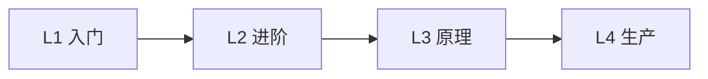

<!--
  生成项目根 README 的模板。{{...}} 为占位符，生成时替换；用不到的小节整节删除。
-->
# {{技术名}} 学习项目

> {{一句话：这个技术解决什么问题}}
>
> 版本：{{核心版本列表，如 JDK 21 / Spring Boot x.y / Spring Cloud 20xx.x}}
> {{如果使用真实云资源：⚠️ 运行部分模块会产生费用，学习结束后执行 ./cleanup.sh}}

## 调研结论

<!-- 版本组合的依据；官方文档之外、通过读源码或实测发现的重要事实。没有就删除这一节 -->
- {{例：最新的 Boot 4.1 对应的 Cloud 2026.0 还处于 RC，因此选用 Boot 4.0.x + Cloud 2025.1.x}}
- {{例：业务代码默认运行在 Factory 的线程池中（源码 Xxx#run），详见 docs/04-xxx.md}}

## 快速开始

```bash
{{启动依赖，如 docker compose up -d}}
{{构建，如 ./mvnw -q -DskipTests package}}
{{运行第一个模块的命令}}
```

预期结果：{{第一个模块跑通后会看到什么}}

## 学习路线



| 级别 | 模块 | 学习目标 | 预计用时 |
|---|---|---|---|
| L1 | [01-xxx](level1-basic/01-xxx/) | {{一句话}} | {{30min}} |
| L2 | ... | ... | ... |
| L3 | ... | ... | ... |

建议：每个模块先读 README 中的「学习目标」，运行看到效果，再按「代码导读」的顺序看代码，最后做「动手练习」。

## 项目结构

```
{{目录树，标注 common 模块中放了什么}}
```

## 外部依赖与端口

| 服务 / 应用 | 端口 | 说明 |
|---|---|---|
| {{nacos}} | {{8848}} | {{注册中心 + 配置中心}} |

## 原理文档

- [00-overview：技术全景](docs/00-overview.md)
- {{docs/NN-xxx.md 列表}}
- [常见坑与排查](docs/faq.md)

## 和你熟悉的技术对照

| {{本技术}} 概念 | 类似于 | 关键区别 |
|---|---|---|
| {{...}} | {{...}} | {{...}} |

## 学完之后

- {{进一步学习的方向 / 官方文档链接}}
